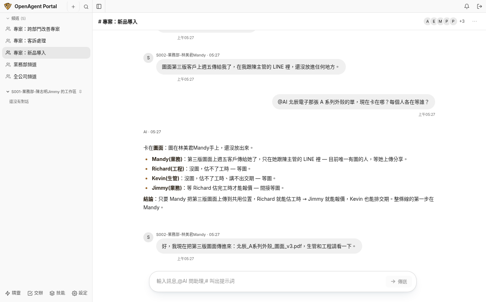

<p align="center"></p>

# OpenAgent Portal: AI your colleagues can actually use, so the team gets things done together.

Colleagues don't need to learn AI first: they leave their work in plain words. The team hands information over in shared channels, AI helps organize, check and carry out the work, and the person responsible confirms the result.

**One person using AI makes one person more capable. A team using AI through channels keeps that capability in the company.**

Self-hosted on your own machine, based on pi-agent and pi-web.

[繁體中文](README.md) · Community Edition 1.1.x-ce · no user limit

---

## TEAM AI in a channel



The project channel 「專案：新品導入」 ("Project: New Product Introduction"). Colleagues each wrote what they are stuck on. Someone asked `@AI` "Where is this order stuck right now? Who is each person waiting for?", and the AI, working from what each person said in the channel, lists who is waiting for whom and whose hands the first step is in. Then the next colleague takes over: Mandy uploads revision 3 of the drawing to the channel and asks production control and engineering to pick it up.
*(Screenshot from a demo machine; the company and the people are fictional. The interface shown is in Chinese.)*

When colleagues each use AI on their own, the information is scattered across everyone's private chats and nobody else can pick it up. When the team uses AI in a shared channel, what was said, what was decided and who is waiting for whom are visible to everyone, and the work can be handed over.

## Three steps

1. **Colleagues leave their work**: in plain words in a channel, what they did and where they are stuck. No need to learn AI first.
2. **The Agent helps**: `@AI` organizes and checks, and uses tools to do the work: filling in forms as PDFs, researching the web, building and testing n8n workflows, making report slide decks.
3. **The team confirms and takes over**: confirming, adopting, completing, approving and publishing are decided by people; the next colleague picks up from the channel.

## Where to start

| You are | Start here |
|---|---|
| **An SME owner or adoption consultant** | **[SME adoption: Taiwan Tech Precision, three months to follow one order all the way through](docs/stories/SME_Story_v1.0_en.md)** ([繁體中文](docs/stories/中小企業主_故事_v1.0.md))<br>Employees first leave their work in their own words; company-wide, department and project channels turn it step by step into work that can be handed over and tracked, growing into a Company Brain. |
| **A teacher** | **[Teacher Workshop: Four Exercises](docs/stories/Teacher_Workshop_Four_Exercises_v1.0_en.md)** ([繁體中文](docs/stories/教師工作坊_四個練習_v1.0.md))<br>A bear on a bicycle (prompts and details), a library card (an Agent uses tools and checks its work), an n8n financial report (Agent and workflow), group research (a team doing research with AI in a channel). |

The companies, schools, people and numbers in the stories are fictional.

## Four main capabilities

- **Team channels**: company-wide, department and project channels where colleagues hand information over and can `@AI` at any time. Wizards look across a channel for you: a daily digest, a weekly work report and meeting summaries (upload a recording or paste a transcript; recordings need a separate speech-to-text service), with a source on every item.
- **Task tracking**: assign work to a person or to the AI; when it is done, the person responsible confirms it. A bulletin board and a bell remind people of what they owe.
- **Shared skills**: built-in skills fill in forms as PDFs, research the web, make report slide decks and help with n8n workflows; work the team does often can become a skill everyone calls. A skill never grants extra permissions.
- **Tools and workflows (n8n)**: the Portal and n8n call each other (webhooks), and the n8n MCP is connected. Anyone can build and test their own flows; only publishing a flow for others needs administrator review.

Also included: local models with a backup, personal keys, passphrase self-registration, user records and an audit log. The full feature list and the edition differences are in [EDITIONS.md](EDITIONS.md) (in Chinese).

## Do it yourself, or bring in a consultant

The Community Edition is free to self-host, and everything it does is in this repo.

> Everything in the Community Edition you can do yourselves. If you want to save time, avoid detours, or have someone accountable for delivery and handover, come to our consulting service.

| Option | What it is |
|---|---|
| Do it yourselves | Follow the manual to set up departments, data and approval habits, and connect existing systems with n8n |
| Teach us | Workshops and hands-on coaching |
| Do it for us | Consulting package: assessment, configuration, testing, training, handover |

The three editions and the suggested adoption path are in [EDITIONS.md](EDITIONS.md).

## Quick install (Docker)

You need a machine that runs Docker (with `docker compose`). Image `ghcr.io/tigerai-taiwan/openagent-portal:1.1.2-ce`, default port **30161**.

1. Get this repo (`compose.yaml` and `.env.example` are in it), copy `.env.example` to `.env`, and fill in at least these three lines:

   ```env
   TIGERAI_ADMIN_EMAIL=you@example.com
   TIGERAI_ADMIN_PASSWORD=<a long password>
   TZ=Asia/Taipei
   ```

2. Start it and open <http://127.0.0.1:30161>:

   ```
   docker compose up -d
   ```

3. Sign in with the administrator from `.env`. **You must change the password at first sign-in.**
4. **Settings -> Model connection**: enter an OpenAI-compatible `/v1` URL and key and press Test. With no local model, a free NVIDIA model works directly; with a local model, add NVIDIA as the backup.
5. Switch on optional services when you need them: `docker compose --profile search --profile convert --profile n8n up -d` (web research / slide and PDF conversion / n8n).

The full guide (`compose.yaml` excerpt, environment variables, LAN access, speech-to-text, backups) is in **[docs/INSTALL.en.md](docs/INSTALL.en.md)** ([繁體中文](docs/INSTALL.md)).

## Data and privacy

**Local first**: your data lives on your own machine (Docker volumes). Data leaves it only in these cases:

- **Backup model**: if you configured a backup (for example NVIDIA), conversations go to it only when the local model fails. The screen says so, and it can be turned off.
- **Personal keys**: when a member adds their own key and chooses it, that conversation goes to the model provider they chose.
- **Web research**: only the search keywords are sent.

**Administrators can read members' conversations** (read-only, every view is audited), and the members' settings page always says so.

## Editions

| | Community (this repo) | Consulting package | Custom commercial |
|---|---|---|---|
| What | Everything above, **no user limit** (actual capacity depends on hardware and models) | A consultant connects your workflows and systems | Per-person permissions, core-system integration |
| How to get it | Install it yourself | From a consultant licensed by TigerAI | Talk to TigerAI |

## License

- Built on [pi-web](https://github.com/agegr/pi-web) (by agegr, MIT) and [pi-agent / pi](https://github.com/earendil-works/pi) (by earendil-works, MIT); license notices are in [NOTICE](NOTICE). This project is **not** an official upstream release.
- The `tigerai/` directory has its own license: the [TigerAI Sustainable Use License](tigerai/LICENSE) (**currently a draft, pending legal review**).
- The logo is a TigerAI trademark and is not covered by the code license (see [tigerai/TRADEMARK.md](tigerai/TRADEMARK.md)).

## Contact

By Morris Lu (盧業興) · n8n Taipei Ambassador · TigerAI (虎智科技), an n8n Expert Partner.

Usage questions, consulting, the teacher's manual and SME adoption manual (PDF), class slides: **morrislu@tigerai.tw**

---

## Upstream pi-web quick start (without the TigerAI layer)

Without `TIGERAI_ENABLED`, this project behaves like upstream pi-web. For the upstream npx quick start, configuration, remote access and development notes, see [docs/UPSTREAM_README.md](docs/UPSTREAM_README.md).
