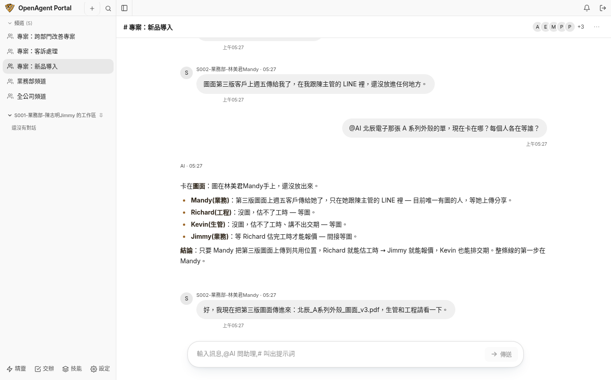

<p align="center"></p>

# OpenAgent Portal：讓同仁用得上 AI，讓團隊一起把事情做完。

同仁不用先學 AI，就能用白話留下工作。團隊在共同頻道裡交接資訊，AI 協助整理、查證與執行，負責的人確認結果。

**個人使用 AI，提升一個人的能力；團隊透過頻道使用 AI，把能力留在公司。**

自架在你自己的機器上，based on pi-agent and pi-web。

[English](README.en.md) · 社群版 1.1.x-ce · 不設人數上限

---

## 頻道裡的 TEAM AI



專案頻道「專案：新品導入」。同仁各自寫下自己卡在哪裡；有人問 `@AI`「這張單現在卡在哪？每個人各在等誰？」，AI 依頻道裡每個人說過的話，列出誰在等誰、整條線的第一步在誰手上；下一位同仁接著做——Mandy 把第三版圖面上傳到頻道，請生管和工程接手。
*（示範機畫面，公司與人物皆為虛構。）*

同仁各自用 AI 時，資訊散在每個人自己的對話裡，別人接不下去。在共同頻道裡用 AI，事情說過什麼、決定了什麼、誰在等誰，大家都看得到、接得下去。

## 三個步驟

1. **同仁留下工作**：用白話在頻道裡寫下做了什麼、卡在哪裡，不用先學 AI。
2. **Agent 協助處理**：`@AI` 整理、查證，也會用工具做事——填表出 PDF、上網查資料、建立與測試 n8n 流程、做報告投影片。
3. **團隊確認與接手**：確認、採用、完成、核准、發布，都由人決定；下一位同仁從頻道裡接著做。

## 從哪裡開始

| 你是 | 從這裡開始 |
|---|---|
| **中小企業主、導入顧問** | **[中小企業導入：虎虎生風精密，三個月把一張單追到底](docs/stories/中小企業主_故事_v1.0.md)**（[English](docs/stories/SME_Story_v1.0_en.md)）<br>同仁先用自己的話留下工作，從全公司、部門到專案頻道，一步步變成接得下去、追得到的工作，長成企業大腦（Company Brain）。 |
| **老師** | **[教師工作坊：四個練習](docs/stories/教師工作坊_四個練習_v1.0.md)**（[English](docs/stories/Teacher_Workshop_Four_Exercises_v1.0_en.md)）<br>熊騎腳踏車（提示詞與細節）、借閱證（Agent 用工具、會檢查）、n8n 財報（Agent 與流程）、分組研究（團隊在頻道裡和 AI 一起做研究）。 |

故事裡的公司、學校、人物與數字皆為虛構。

## 四個主要功能

- **團隊頻道**：全公司、部門、專案頻道，同仁在裡面交接資訊，隨時 `@AI`。精靈幫忙看整個頻道：每日摘要、工作週報、會議摘要（上傳錄音或貼逐字稿；錄音轉文字需另接語音轉文字服務），每一項都附出處。
- **交辦追蹤**：工作交給人或交給 AI，做完要負責的人確認；公佈欄與鈴鐺提醒欠的事。
- **共享技能**：內建填表出 PDF、上網找參考資料、做報告投影片、n8n 流程助手；做熟的事可以變成技能，大家一起叫用。技能不會多給權限。
- **工具與流程（n8n）**：Portal 與 n8n 互相呼叫（webhook），並接上 n8n MCP；每個人都能自己建、測流程，上架給別人用才要管理員審查。

另外還有地端模型加備援、個人金鑰、通關密語註冊、使用者紀錄與稽核。完整功能清單與版本差異見 [EDITIONS.md](EDITIONS.md)。

## 自己來，或找顧問

社群版免費自架，功能都在這個 repo 裡。

> 社群版的東西，你們都可以自己動手。要省時間、少走冤枉路，或想要有人負責交付和交接，再來找顧問服務。

| 買法 | 內容 |
|---|---|
| 自己來 | 照手冊自己建部門、資料、核准習慣，用 n8n 接既有系統 |
| 教我們做 | 工作坊、陪跑 |
| 幫我們做 | 顧問包：診斷、配置、測試、訓練、交接 |

三個版本與建議的導入路徑見 [EDITIONS.md](EDITIONS.md)。

## 快速安裝（Docker）

需要能跑 Docker 的機器（含 `docker compose`）。映像 `ghcr.io/tigerai-taiwan/openagent-portal:1.1.2-ce`，預設埠 **30161**。

1. 取得本 repo（`compose.yaml` 與 `.env.example` 都在裡面），把 `.env.example` 複製成 `.env`，最少填這三行：

   ```env
   TIGERAI_ADMIN_EMAIL=you@example.com
   TIGERAI_ADMIN_PASSWORD=<請設定很長的密碼>
   TZ=Asia/Taipei
   ```

2. 啟動，瀏覽器開 <http://127.0.0.1:30161>：

   ```
   docker compose up -d
   ```

3. 用 `.env` 的管理員登入。**第一次登入一定要先改密碼。**
4. **設定 → 模型連線**：填 OpenAI 相容 `/v1` 網址與金鑰，按「測試」。沒有地端模型可以直接用 NVIDIA 免費模型；有地端模型時，再加 NVIDIA 當備援。
5. 選配服務要用再開：`docker compose --profile search --profile convert --profile n8n up -d`（上網查資料／投影片與 PDF 轉檔／n8n）。

完整說明（`compose.yaml` 節錄、環境變數、區網連線、語音轉文字、備份）見 **[docs/INSTALL.md](docs/INSTALL.md)**。

## 資料與隱私

**地端優先**：資料放在你自己的機器上（Docker volume）。只有下面這幾種情況，資料會送出去：

- **備援模型**：你設定了備援（例如 NVIDIA），而且地端模型故障時，對話才改走備援。畫面會標示，可以關閉。
- **個人金鑰**：成員加了自己的金鑰並選用時，那段對話會送到他選的模型服務商。
- **上網查資料**：只送查詢關鍵字。

**管理員可以查看成員的對話**（唯讀、每次查看都記稽核），成員的設定頁固定告知這件事。

## 版本

| | 社群版（本 repo） | 顧問包 | 商業客製版 |
|---|---|---|---|
| 內容 | 上面所有功能，**不設人數上限**（實際容量取決於硬體與模型） | 顧問帶著把流程與系統接好 | 依個人管權限、串核心系統 |
| 取得 | 自行安裝 | 由虎智授權的顧問提供 | 與虎智洽談 |

## 授權

- 以 [pi-web](https://github.com/agegr/pi-web)（agegr，MIT）與 [pi-agent / pi](https://github.com/earendil-works/pi)（earendil-works，MIT）為基礎，授權聲明見 [NOTICE](NOTICE)。本專案**不是**上游的官方版本。
- `tigerai/` 目錄有自己的授權：[TigerAI Sustainable Use License](tigerai/LICENSE)（**目前是草稿，待法律審閱**）。
- Logo 為 TigerAI 商標，不在程式授權範圍內（見 [tigerai/TRADEMARK.md](tigerai/TRADEMARK.md)）。

## 聯絡

作者：盧業興 Morris Lu · n8n Taipei Ambassador · 虎智科技 TigerAI（n8n Expert Partner）

使用問題、顧問服務、老師使用手冊與中小企業導入手冊（PDF）、上課投影片：**morrislu@tigerai.tw**

---

## 上游 pi-web 快速開始（不啟用 TigerAI 層）

不設 `TIGERAI_ENABLED` 時，本專案行為與上游 pi-web 相同。上游的 npx 快速開始、設定、遠端存取與開發說明，請見 [docs/UPSTREAM_README.md](docs/UPSTREAM_README.md)。
